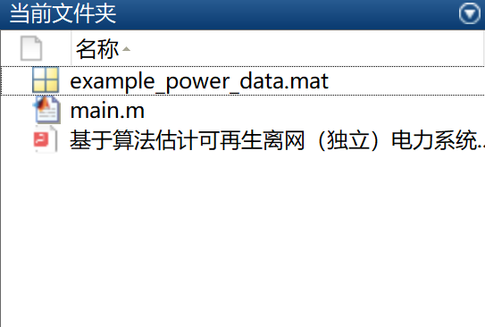

# Algorithm-based Estimation of Photovoltaic System Scale and Energy Storage Capacity for Renewable Off-Grid (Independent) Power Systems (Matlab Code Implementation)

The power system delivers electricity to homes and buildings, powering devices plugged into sockets such as televisions, refrigerators, computers, and others. The Sustainable Energy Generation System (SEGS) is an independent power system that independently generates electricity from renewable sources. The two main components of SEGS are the Renewable Energy Source (RES) and Energy Storage System (ESS). The primary challenge in designing SEGS is determining how much renewable energy and energy storage are needed to provide reliable and independent power throughout the year. There are theoretically an infinite number of possible configurations by considering large generation scales. A novel algorithm has been developed to approximate all possible configurations of SEGS's solar photovoltaic (PV) and energy storage systems, revealing a proportional relationship between ultra-large PV and energy storage.

## Images

<!-- PAYMENT_BLOCK -->

## Get this dataset

- Payment link (Stripe): [Buy now](https://buy.stripe.com/3cs8yP7sY87d0vu9AB)
- Payment QR code: 

<!-- /PAYMENT_BLOCK -->
